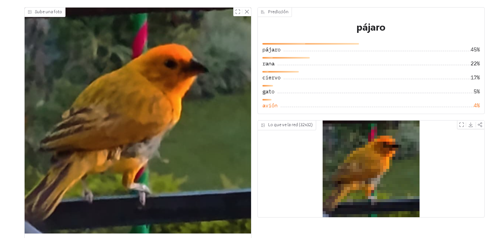
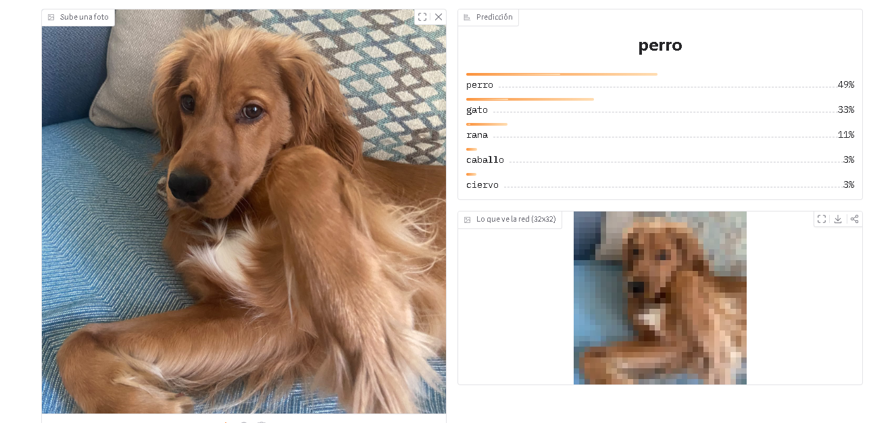

# CIFAR-10 Image Classifier with a Custom CNN

A convolutional neural network built and trained from scratch in PyTorch to classify images from the CIFAR-10 dataset, served through a Gradio web app. Developed as a Computer Vision assignment (deep learning application).



## Task

Image classification into 10 classes: airplane, automobile, bird, cat, deer, dog, frog, horse, ship, truck.

## Dataset

[CIFAR-10](https://www.cs.toronto.edu/~kriz/cifar.html): 60,000 color images of 32×32 pixels.

| Split | Images | Source |
|---|---|---|
| Train | 45,000 | Random part of the original training set |
| Validation | 5,000 | Random part of the original training set (seed 42) |
| Test | 10,000 | Original test set, used only for the final evaluation |

The dataset is downloaded automatically by `torchvision` into `data/`.

## Model

Custom CNN with 3 convolutional blocks and a small classifier head (620,810 parameters):

```
Input 3×32×32
[Conv2d 3×3 → BatchNorm → ReLU → MaxPool 2×2] × 3   (32, 64, 128 filters)
Flatten (2048)
Dropout(0.5) → Linear(2048, 256) → ReLU
Dropout(0.5) → Linear(256, 10)
```

The network outputs logits. Softmax is applied only at prediction time (inside `CrossEntropyLoss` during training).

## Training setup

| Setting | Value |
|---|---|
| Optimizer | SGD with momentum 0.9 |
| Learning rate | 0.01, multiplied by 0.1 every 7 epochs (StepLR) |
| Batch size | 64 |
| Epochs | 20 |
| Loss | CrossEntropyLoss |
| Augmentation (train only) | Random crop (padding 4), horizontal flip |
| Normalization | Per-channel CIFAR-10 mean and std |
| Seed | 42 |
| Environment | CPU only, PyTorch 2.15.0+cpu |

## Results

| Metric | Value |
|---|---|
| Validation accuracy (best epoch) | 76.7 % |
| Test accuracy | 75.94 % |
| Test precision (macro) | 75.81 % |
| Test recall (macro) | 75.94 % |
| Test F1-score (macro) | 75.83 % |
| Training time | 25.7 min (CPU) |
| Inference time | 0.96 ms per image (forward pass only, CPU, single image, average of 200) |

Generated plots: `curvas.png` (loss and accuracy per epoch) and `matriz_confusion.png` (confusion matrix).

## Project structure

```
datos.py             Data loading, train/val/test split, augmentation
modelo.py            CNN definition
entrenar.py          Training loop, saves the best model and history
evaluar.py           Test metrics, confusion matrix, curves, inference time
app.py               Gradio app
modelo.pth           Trained weights (best validation epoch)
historial.json       Per-epoch training history and training time
metricas.json        Test metrics and inference time
curvas.png           Training curves
matriz_confusion.png Confusion matrix
fotos/               Photos taken with a phone for real-world testing
```

## Installation

Requires Python 3.10 or newer.

```bash
python -m venv cv_env

# Windows
cv_env\Scripts\activate
# macOS / Linux
source cv_env/bin/activate

pip install torch torchvision scikit-learn matplotlib gradio
```

## Usage

The trained weights (`modelo.pth`) are included, so you can run the app without training.

**Run the app**

```bash
python app.py
```

Open `http://127.0.0.1:7860` in your browser, upload an image and see the predicted class probabilities. The app also shows the 32×32 version of the image that the network actually receives.

**Retrain the model** (overwrites `modelo.pth` and `historial.json`)

```bash
python entrenar.py
```

**Evaluate on the test set**

```bash
python evaluar.py
```

## Limitations

- CIFAR-10 images are tiny, centered, single-object crops. Phone photos with cluttered backgrounds, different angles or lighting differ a lot from the training data, so accuracy on real photos is lower than on the test set.
- Cat and dog are the most commonly confused classes at 32×32 resolution.
- The network was trained from scratch on a small dataset, without pretrained weights.

